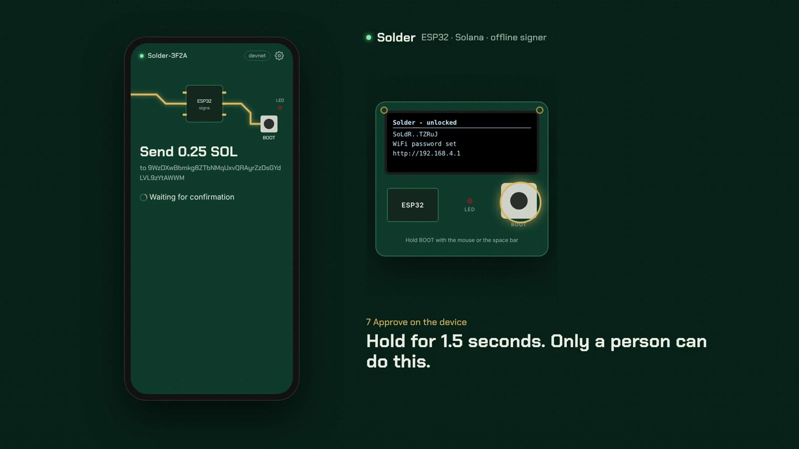

# Solder

A Solana hardware wallet you build yourself from a $5 ESP32.

Solder makes your keys, keeps them encrypted with your PIN, and never goes online. It runs its own WiFi; your phone joins it, asks for a signature, and Solder signs only after you hold its BOOT button. The phone reads balances from Solana and broadcasts what Solder signed.

Built on [Infratic-lib](https://github.com/infraticxyz-lab/Infratic-lib), the Solana library for ESP32.



## What it does

- Runs only its own WiFi access point. No station mode, no internet, no RPC calls from the device
- Factory WiFi password `admin123`; on first start the page asks for a new one, Solder restarts, and you join again with it
- Creates a wallet on the device (12 or 24 backup words, same addresses as Phantom and Solflare) or restores one
- Keeps the secret encrypted in flash with AES-256-GCM, key derived from your PIN; erases itself after 10 wrong PINs
- Builds and signs SOL and SPL / Token-2022 transfers itself, signs messages
- Every signature needs BOOT held for 1.5 s; a request expires after 45 s
- Optional OLED that shows what is being signed, independent of the phone

## How the pieces talk

```
 phone browser ──WiFi──> Solder (ESP32)            phone browser ──internet──> Solana RPC
   asks: send 0.25 SOL      shows it, waits for BOOT     reads balance, blockhash
   + recent blockhash       builds + signs the tx        broadcasts the signed tx
```

Your phone needs mobile data (or a second network) for balances and sending. Creating a wallet, signing messages and all key handling work with no internet at all.

## Hardware

| Part | Notes |
| --- | --- |
| ESP32 DevKit (ESP32-WROOM-32) | Any board with the BOOT button on GPIO0 |
| USB cable | For flashing and power |
| SSD1306 0.96" OLED, I2C (optional) | SDA 21, SCL 22, 3V3, GND |

## Build and flash

Install [PlatformIO](https://platformio.org/install), then:

```bash
pio run -e esp32dev -t upload          # board only
pio run -e esp32dev-oled -t upload     # with the OLED
pio device monitor
```

The web page in `web/index.html` is packed into the firmware on every build (`web/build.py`).

## First start

1. Join the WiFi `Solder-XXXX` with the password `admin123`. The page opens by itself, or go to `http://192.168.4.1`.
2. Choose a new WiFi password. Solder restarts; join again with the new password and the page continues.
3. Create a wallet, write the words on paper, choose a 6-digit PIN.
4. On devnet, tap "Get 1 test SOL", then Send. Hold BOOT when the page asks.

## Try it without a board

```bash
tools/run.sh            # first start: factory password, no wallet
tools/run.sh --ready    # skip setup, PIN 123456
```

This starts `tools/simulator.py`, a stand-in for the device and a small fake Solana network, and opens two pages: the wallet (`http://localhost:8080`) and a virtual board with its screen and BOOT button (`http://localhost:8080/device`, hold the button with the mouse or the space bar).

## Source

```
src/main.cpp      access point, mDNS, boot
src/solder.cpp    settings, PIN session, button and LED, building and signing transactions
src/web.cpp       HTTP API, captive portal, request checks
src/display.cpp   optional OLED
web/index.html    the wallet page (packed into src/web_ui.h)
tools/            simulator and run script
docs/SECURITY.md  what Solder protects against, and what it does not
```

| Endpoint | |
| --- | --- |
| `GET /api/state` | wallet, network, password status |
| `POST /api/ap-password` | set the WiFi password, then restart |
| `POST /api/setup/generate`, `/api/setup/finish` | create or restore |
| `POST /api/unlock`, `/api/lock` | PIN session |
| `POST /api/send`, `/api/sign`, `/api/wipe` | create a request for the button |
| `GET /api/request`, `POST /api/request/reject` | follow or cancel it; a signed send returns the transaction |
| `POST /api/network` | devnet, mainnet or your own RPC (used by the phone) |

## Security

Read [docs/SECURITY.md](docs/SECURITY.md) before you put real funds on it. In short: a plain ESP32 has no secure element, so turn on flash encryption for anything beyond testing, and use the OLED build so you can see what you sign.

## License

MIT
